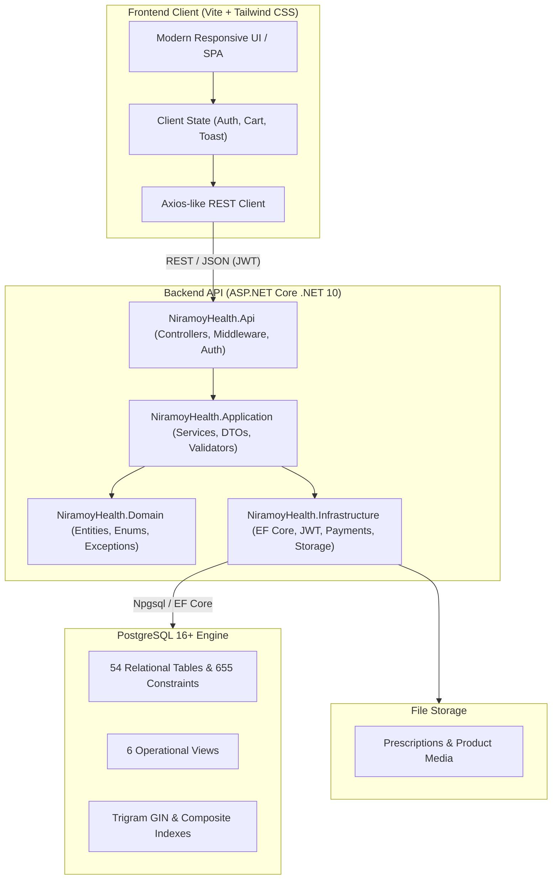

# Niramoy Health (নিরাময় হেলথ)

[](https://github.com/arif-z04/Niramoy-Health/actions/workflows/ci.yml)
[](https://dotnet.microsoft.com/)
[](https://www.postgresql.org/)
[](https://vitejs.dev/)
[](https://tailwindcss.com/)
[](https://playwright.dev/)
[](LICENSE)

An enterprise-grade digital pharmacy and healthcare e-commerce platform tailored for Bangladesh. Built with **Clean Architecture** in **ASP.NET Core (.NET 10)**, a resilient **PostgreSQL** relational engine, and a fast, modern **Vite & Tailwind CSS** storefront.

---

## 🌟 Key Features

- **Clinical Prescription Workflow**: Secure multi-file prescription uploads (`.jpg`, `.png`, `.pdf`) with pharmacist review triage, status tracking, and BMDC-compliant validation before dispensing.
- **Bangladeshi Localization**:
  - Full administrative geographic hierarchy (8 Divisions, 64 Districts, Upazilas/Thanas).
  - Mobile Financial Services (MFS) integration: **bKash**, **Nagad**, and **Cash on Delivery (COD)**.
  - Bilingual typography and UI elements in English and Bengali (বাংলা) with `Hind Siliguri` font and `৳` currency formatting.
- **Catalog & Smart Search**: Instant debounced search with trigram fuzzy matching (`pg_trgm`), category filtering, dosage forms, and generic drug alternatives.
- **Atomic Inventory & Overselling Protection**: Two-phase reservation model (`quantity_on_hand` vs `quantity_reserved`) backed by database engine constraints and double-entry stock movement ledgers.
- **Guest & Persistent Cart Merge**: Seamless cart migration from unauthenticated guest tokens (`X-Guest-Token`) into user accounts upon login.
- **Multi-Role Security**: Role-Based Access Control (RBAC) with secure JWT authentication and role guards separating `Customer`, `Pharmacist`, and `Admin` portals.
- **Responsive Across All Viewports**: Rigorously audited and tested across 320px (small phone), 375px (standard mobile), 768px (tablet), and 1280px (desktop).

---

## 🏗️ Architecture Overview



---

## 📁 Repository Structure

```
.
├── .github/
│   └── workflows/
│       └── ci.yml               # GitHub Actions CI build & test pipeline
├── backend/
│   ├── NiramoyHealth.slnx       # .NET Solution file
│   ├── Directory.Build.props    # Central build properties (.NET 10)
│   ├── src/
│   │   ├── NiramoyHealth.Api/            # ASP.NET Core Web API host & endpoints
│   │   ├── NiramoyHealth.Application/    # Business services, interfaces, validators
│   │   ├── NiramoyHealth.Domain/         # Core domain entities, exceptions, enums
│   │   └── NiramoyHealth.Infrastructure/ # EF Core DbContext, auth, payments, storage
│   ├── tests/
│   │   ├── NiramoyHealth.UnitTests/      # Business logic & pricing unit tests (40 tests)
│   │   └── NiramoyHealth.IntegrationTests/ # WebApplicationFactory integration tests (9 tests)
│   └── NiramoyHealth.DbVerification/    # Standalone connection diagnostic tool
├── frontend/
│   ├── package.json             # Frontend dependencies and scripts
│   ├── vite.config.js           # Vite dev server and proxy configuration
│   ├── tailwind.config.js       # Clinical emerald theme tokens
│   ├── src/
│   │   ├── api/                 # Modular API client endpoints
│   │   ├── components/          # Reusable UI components (Header, Footer, Drawers)
│   │   ├── pages/               # Storefront, Catalog, Rx Upload, Admin pages
│   │   ├── state/               # Lightweight reactive stores
│   │   └── router.js            # Hash-based SPA router with role guards
│   └── tests/                   # Playwright E2E suites & visual audit runners
├── sql/
│   ├── 001_create_database.sql  # Database creation with UTF-8 encoding
│   ├── 002_create_extensions.sql# Extensions (uuid-ossp, pgcrypto, pg_trgm, citext)
│   ├── 003..012_*.sql           # Domain schema tables, constraints, indexes
│   ├── 013_seed_reference_data.sql # BD divisions, districts, thanas, roles
│   ├── 014_seed_demo_data.sql   # Authentic BD medicine catalog & demo users
│   ├── 016_database_health_checks.sql # Integrity diagnostics
│   └── rollback/                # Complete rollback scripts for every migration
├── docs/                        # Complete architecture, API, and deployment documentation
│   ├── api-reference.md         # Full REST API endpoint reference
│   ├── backend-architecture.md  # Backend design patterns and layers
│   ├── database-design.md       # Entity relationships & schema specifications
│   ├── deployment-guide.md      # Production deployment and containerization
│   └── environment-configuration.md # Feature matrix & configuration guide
├── tests/
│   └── database/
│       └── run_tests.py         # 15-point automated PostgreSQL test runner
├── .env.example                 # Environment variable template
├── .gitattributes               # Cross-platform LF line endings normalization
├── .gitignore                   # Ignores secrets, build outputs, node_modules
└── LICENSE                      # MIT Open Source License
```

---

## 🚀 Quickstart Guide

### Prerequisites

- [.NET 10.0 SDK](https://dotnet.microsoft.com/download)
- [Node.js 20+](https://nodejs.org/) & `npm`
- [PostgreSQL 16+](https://www.postgresql.org/download/)
- [Git](https://git-scm.com/)

---

### 1. Clone & Configure Environment

```bash
# Clone the repository
git clone https://github.com/arif-z04/Niramoy-Health.git
cd Niramoy-Health

# Create your local environment configuration
cp .env.example .env
```

Review `.env` and configure your database credentials and JWT secrets if different from defaults.

---

### 2. Database Setup

Execute the SQL scripts in sequential order against your PostgreSQL server:

```bash
# Step 1: Create database and user (run as postgres superuser)
psql -U postgres -h 127.0.0.1 -f sql/001_create_database.sql

# Step 2: Apply schema scripts (run as niramoy_user)
psql -U niramoy_user -h 127.0.0.1 -d niramoy_health_dev -f sql/002_create_extensions.sql
psql -U niramoy_user -h 127.0.0.1 -d niramoy_health_dev -f sql/003_create_users_and_roles.sql
psql -U niramoy_user -h 127.0.0.1 -d niramoy_health_dev -f sql/004_create_catalog.sql
psql -U niramoy_user -h 127.0.0.1 -d niramoy_health_dev -f sql/005_create_inventory.sql
psql -U niramoy_user -h 127.0.0.1 -d niramoy_health_dev -f sql/006_create_carts_and_wishlists.sql
psql -U niramoy_user -h 127.0.0.1 -d niramoy_health_dev -f sql/007_create_prescriptions.sql
psql -U niramoy_user -h 127.0.0.1 -d niramoy_health_dev -f sql/008_create_orders_and_payments.sql
psql -U niramoy_user -h 127.0.0.1 -d niramoy_health_dev -f sql/009_create_delivery_and_promotions.sql
psql -U niramoy_user -h 127.0.0.1 -d niramoy_health_dev -f sql/010_create_notifications_and_support.sql
psql -U niramoy_user -h 127.0.0.1 -d niramoy_health_dev -f sql/011_create_audit_and_reporting.sql
psql -U niramoy_user -h 127.0.0.1 -d niramoy_health_dev -f sql/012_create_indexes_and_constraints.sql

# Step 3: Seed reference & demo catalog data
psql -U niramoy_user -h 127.0.0.1 -d niramoy_health_dev -f sql/013_seed_reference_data.sql
psql -U niramoy_user -h 127.0.0.1 -d niramoy_health_dev -f sql/014_seed_demo_data.sql

# Step 4: Verify schema integrity
psql -U niramoy_user -h 127.0.0.1 -d niramoy_health_dev -f sql/016_database_health_checks.sql
```

---

### 3. Run Backend API

```bash
cd backend/src/NiramoyHealth.Api
dotnet run
```

The API starts on `http://localhost:5000` (or `https://localhost:5001`). Swagger / OpenAPI documentation is available at `http://localhost:5000/swagger`.

---

### 4. Run Frontend Storefront

In a new terminal window:

```bash
cd frontend
npm install
npm run dev
```

Open `http://localhost:5173` in your browser.

---

## 👥 Pre-Seeded Test Credentials

| Role | Email / Phone | Password | Access Rights |
|---|---|---|---|
| **Customer** | `customer@niramoyhealth.com` *(or `01712345678`)* | `Password123!` | Storefront browsing, cart, prescription upload, checkout |
| **Pharmacist** | `pharmacist@niramoyhealth.com` | `Pharma123!` | Prescription triage & clinical approval queue |
| **Administrator** | `admin@niramoyhealth.com` | `Admin123!` | KPI metrics, inventory, user management, order dispatch |

---

## 🧪 Testing

### Backend Unit & Integration Tests (xUnit)

```bash
dotnet test backend/NiramoyHealth.slnx
```
Runs 40 Unit Tests and 9 Integration Tests verifying pricing logic, discount codes, checkout validation, and database operations.

### Frontend E2E & Visual Regression Tests (Playwright)

```bash
cd frontend
npm run test:e2e
```
Executes Playwright tests across chromium, webkit, and mobile viewports (`320px`, `375px`, `768px`, and `1280px`).

### Database Integrity Verification Suite

```bash
python3 tests/database/run_tests.py
```
Validates all 15 database constraints, foreign-key enforcement, decimal precision, idempotency, and rollback execution.

---

## 📚 Documentation Index

Comprehensive engineering guides are available in the [`docs/`](docs/) directory:

- [API Reference](docs/api-reference.md) — Complete specification of all REST endpoints.
- [Backend Architecture](docs/backend-architecture.md) — Domain-Driven Design, services, and middleware.
- [Database Design](docs/database-design.md) — Schema breakdown, ER diagrams, and normalization rules.
- [Database Setup Guide](docs/database-setup.md) — Step-by-step database provisioning and configuration.
- [Authentication & Security](docs/authentication.md) — JWT issuance, refresh tokens, and RBAC policies.
- [Payment Integration](docs/payment-integration.md) — MFS gateway specifications for bKash and Nagad.
- [Frontend Architecture](docs/frontend-architecture.md) — Single-Page Application router and state management.
- [UI Pages & Components](docs/ui-pages-and-components.md) — UI design specifications and component hierarchy.
- [Responsive Audit & Testing](docs/responsive-audit.md) — Multi-viewport responsiveness audit findings.
- [Deployment Guide](docs/deployment-guide.md) — Production readiness, Docker, and reverse proxy setup.
- [Environment Configuration](docs/environment-configuration.md) — Environment variables and feature matrix.

---

## 📄 License

This project is licensed under the MIT License — see the [LICENSE](LICENSE) file for details.
