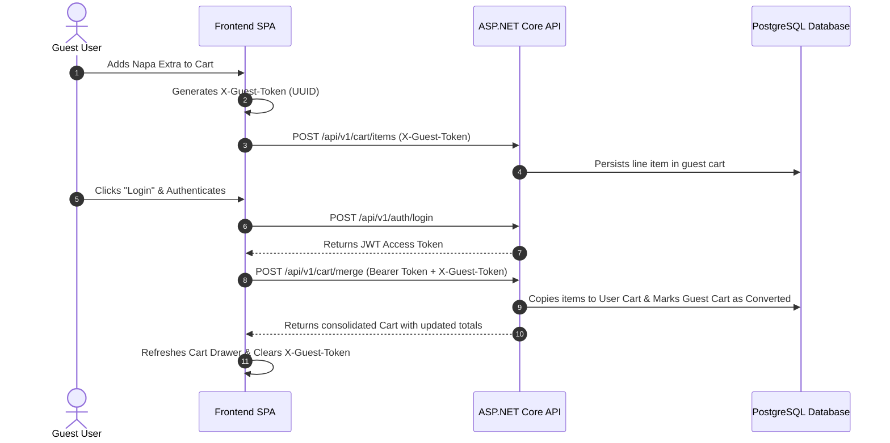

# Niramoy Health (নিরাময় হেলথ) — API Integration Guide

## 1. Overview & Transport Contract

The frontend connects directly to the ASP.NET Core Web API (running locally at `http://127.0.0.1:5131` or reverse-proxied at `/api`). All communication follows RESTful JSON conventions, standard HTTP status codes, and an API response wrapper envelope.

### Base URLs & Environment
- **Development**: `/api` (proxied by Vite to `http://127.0.0.1:5131/api/v1`)
- **Direct Backend**: `http://127.0.0.1:5131/api/v1`
- **Production**: `/api/v1` (served reverse-proxied via Nginx or self-hosted ASP.NET Core)

---

## 2. Authentication & Header Conventions

### 2.1. Request Headers
Every client request includes the appropriate headers managed by `src/api/client.js`:

| Header | Purpose | Example |
|---|---|---|
| `Accept` | Requested media type | `application/json` |
| `Content-Type` | Payload serialization | `application/json` (omitted for `multipart/form-data`) |
| `Authorization` | JWT access token for authenticated users | `Bearer eyJhbGciOi...` |
| `X-Guest-Token` | Anonymous visitor identifier for guest carts | `3fa85f64-5717-4562-b3fc-2c963f66afa6` |
| `X-Client-Version` | Frontend bundle version | `1.0.0` |

### 2.2. Standard Response Envelope
All API endpoints return a standardized payload envelope:

```typescript
interface ApiResponse<T> {
  success: boolean;
  message?: string;
  data: T;
  errors?: Record<string, string[]> | null;
  timestamp: string;
}
```

### 2.3. Error Normalization
The frontend HTTP client (`src/api/client.js`) intercepts errors and normalizes them into human-readable notifications:
- **HTTP 400 (Bad Request)**: Aggregates validation error messages from `errors` dictionary.
- **HTTP 401 (Unauthorized)**: Clears expired tokens, notifies user, and redirects to `#/login?redirect=...`.
- **HTTP 403 (Forbidden)**: Alerts user of insufficient administrative privileges.
- **HTTP 404 (Not Found)**: Displays localized message for missing resources.
- **HTTP 422 (Unprocessable Entity)**: Surfacing business rule violations (e.g., inventory shortage or invalid coupon).
- **HTTP 500 (Internal Server Error)**: Displays friendly Bengali/English server maintenance banner without leaking stack traces.

---

## 3. Core API Service Modules

### 3.1. Authentication (`src/api/auth.js`)
| Method | Endpoint | Description |
|---|---|---|
| `POST` | `/auth/register` | Register new customer with phone, email, and password. |
| `POST` | `/auth/login` | Authenticate customer or administrator, returns JWT + Refresh Token. |
| `POST` | `/auth/refresh` | Exchange refresh token for fresh access token. |
| `GET` | `/users/me` | Fetch currently authenticated user profile and addresses. |
| `POST` | `/users/me/addresses` | Add new delivery address in Bangladesh. |

### 3.2. Catalog & Products (`src/api/catalog.js`)
| Method | Endpoint | Description |
|---|---|---|
| `GET` | `/products` | Filtered and paginated medicine catalog (query params: `categoryId`, `brandId`, `search`, `page`, `pageSize`, `sortBy`). |
| `GET` | `/products/featured` | Fetch featured items for homepage carousel. |
| `GET` | `/products/deals` | Fetch discounted healthcare deals and promotions. |
| `GET` | `/products/slug/{slug}` | Product details by URL slug, including generic composition and stock status. |
| `GET` | `/categories` | Fetch category taxonomy tree with icons and product counts. |
| `GET` | `/brands` | Fetch leading Bangladeshi pharmaceutical manufacturers (Square, Beximco, etc.). |

### 3.3. Shopping Cart (`src/api/cart.js`)
| Method | Endpoint | Description |
|---|---|---|
| `GET` | `/cart` | Retrieve active cart for user or guest (`X-Guest-Token`). |
| `POST` | `/cart/items` | Add product to cart with quantity validation. |
| `PUT` | `/cart/items/{id}` | Update quantity of a line item. |
| `DELETE` | `/cart/items/{id}` | Remove line item from cart. |
| `POST` | `/cart/merge` | Merge guest items into customer cart post-login. |

### 3.4. Prescriptions (`src/api/prescriptions.js`)
| Method | Endpoint | Description |
|---|---|---|
| `POST` | `/prescriptions/upload` | Multipart file upload (`image/*`, `.pdf`) with optional notes. |
| `GET` | `/prescriptions/mine` | Customer's submitted prescriptions and verification statuses. |
| `GET` | `/prescriptions/pending` | Staff/pharmacist review queue. |
| `POST` | `/prescriptions/{id}/review` | Pharmacist decision (`approved` or `rejected`) with clinical dosage guidance. |

### 3.5. Checkout & Orders (`src/api/checkout.js` & `src/api/orders.js`)
| Method | Endpoint | Description |
|---|---|---|
| `POST` | `/orders/checkout` | Convert cart into confirmed order with selected address and payment method. |
| `GET` | `/orders` | Order history for authenticated user. |
| `GET` | `/orders/{orderNumber}` | Full order tracking details and invoice breakdown. |
| `POST` | `/orders/{id}/cancel` | Cancel order before dispatch. |

### 3.6. Administrative Portal (`src/api/admin.js`)
| Method | Endpoint | Description |
|---|---|---|
| `GET` | `/admin/dashboard/summary` | Real-time counts: gross sales, open orders, pending prescriptions. |
| `GET` | `/admin/orders` | Manage store orders across all fulfillment stages. |
| `PATCH` | `/admin/orders/{id}/status` | Transition order status (`confirmed` ➔ `processing` ➔ `dispatched` ➔ `delivered`). |
| `POST` | `/prescriptions/{id}/review` | Staff approval/rejection with clinical notes. |

---

## 4. Guest Cart Merging Flow

When an anonymous user adds medicines to their cart and subsequently logs in or registers:



---

## 5. Security & Safety Compliance

1. **Token Storage**: Access tokens are kept in secure local storage and passed in the `Authorization: Bearer` header.
2. **Prescription Security**: Prescription images are stored securely on the backend server (`backend/src/NiramoyHealth.Api/storage/prescriptions/`) and are accessible only to the customer who uploaded them or authorized staff members with clinical roles (`Admin`, `Pharmacist`).
3. **Price Calculation Integrity**: All price calculations, discounts, and delivery fees are computed server-side in C# and verified against PostgreSQL records to prevent client-side price tampering.
