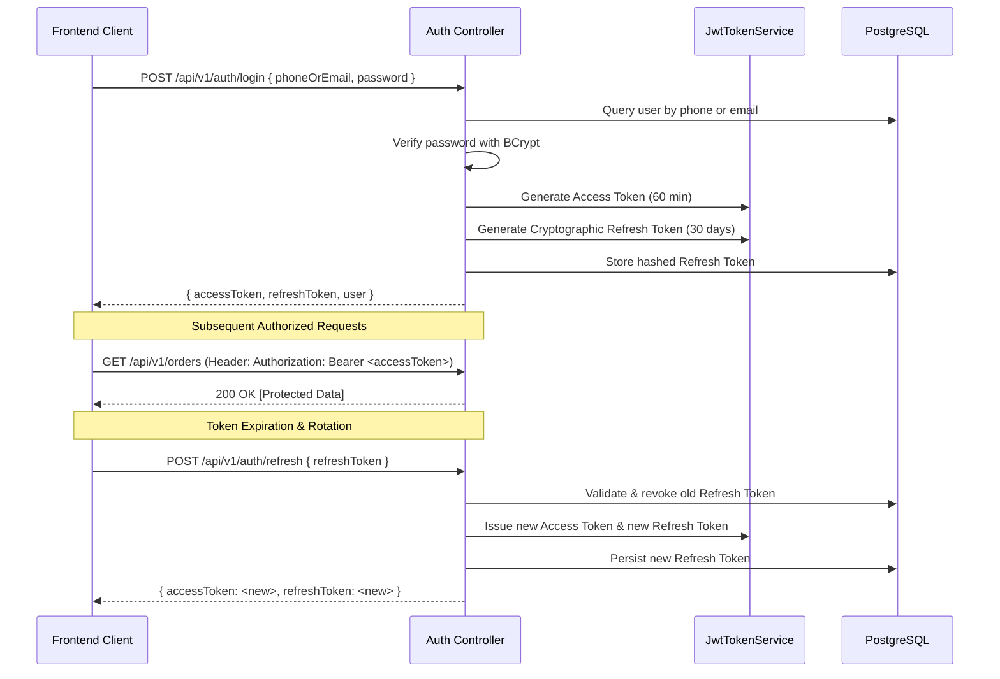

# Niramoy Health (নিরাময় হেলথ) — Authentication & Security Architecture

## 1. Authentication Overview

Niramoy Health implements a dual-token **JWT (JSON Web Token) + Refresh Token** architecture designed for secure web and mobile client applications.

---

## 2. Token Specifications

### 2.1. Access Token (JWT)
- **Algorithm**: `HMAC-SHA256` (`HS256`).
- **Secret Key Length**: Minimum 256 bits (32+ characters) configured in `Jwt:Secret`.
- **Validity Lifetime**: Default **60 minutes**.
- **Standard & Custom Claims**:
  - `sub`: Internal PostgreSQL `users.id` (numeric string).
  - `jti`: Unique token identifier (`Guid`).
  - `email`: User email address.
  - `name`: User full name.
  - `role`: Array of role names mapped from `user_roles` (e.g. `customer`, `pharmacist`, `admin`, `super_admin`).
  - `phone_number`: Verified Bangladeshi phone number.

### 2.2. Refresh Token
- **Format**: Cryptographically secure 64-byte random byte sequence encoded in Base64Url (`RandomNumberGenerator`).
- **Storage**: Persisted in PostgreSQL table `user_refresh_tokens`.
- **Validity Lifetime**: Default **30 days**.
- **Rotation Policy**: Absolute rotation on every refresh request. When a refresh token is presented, it is immediately marked as revoked and replaced with a newly generated token.
- **Family / Replay Protection**: If a previously revoked refresh token is re-submitted, the token family is flagged to mitigate credential reuse attacks.

---

## 3. Password Security & Hashing

- **Hashing Algorithm**: **BCrypt** with salt factor `12`.
- **Input Validation**:
  - Minimum 8 characters.
  - Requires at least one uppercase letter (`[A-Z]`).
  - Requires at least one lowercase letter (`[a-z]`).
  - Requires at least one number (`[0-9]`).
  - Requires at least one special character (`[!@#$%^&*...]`).
- **Timing Attacks**: Password comparison uses constant-time verification logic within the BCrypt library.

---

## 4. Role-Based Access Control (RBAC)

The platform enforces 6 distinct roles defined in `NiramoyHealth.Domain.Enums.RoleNames`:

| Role Name | Scope & Permissions |
|---|---|
| `customer` | Default for registered users. Browse products, manage cart/addresses, upload prescriptions, place orders, make payments, open support tickets. |
| `pharmacist` | Clinical prescription review queue, verify dosage and prescription legality, approve/reject submitted prescriptions. |
| `delivery_agent` | Order fulfillment, delivery status updates (`out_for_delivery`, `delivered`), cash collection on delivery. |
| `support_agent` | Customer service helpdesk, reply to support tickets, view order tracking. |
| `admin` | Full operational access: product management, inventory controls, order lifecycle updates, refund issuance, staff management. |
| `super_admin` | Global administrative permissions including database maintenance, security controls, and role assignment. |

---

## 5. Security Middlewares & Headers

1. **`SecurityHeadersMiddleware`**:
   - `X-Frame-Options: DENY` (Clickjacking prevention).
   - `X-Content-Type-Options: nosniff` (MIME sniffing prevention).
   - `X-XSS-Protection: 1; mode=block`.
   - `Referrer-Policy: strict-origin-when-cross-origin`.
   - `Content-Security-Policy: default-src 'self'`.
   - `Strict-Transport-Security: max-age=31536000; includeSubDomains` (In production).

2. **`ExceptionHandlingMiddleware`**:
   - Catches all unhandled exceptions centrally.
   - Prevents sensitive stack traces and database schema leakages to clients.
   - Returns sanitized RFC-compliant error payloads with unique trace IDs for correlation.
