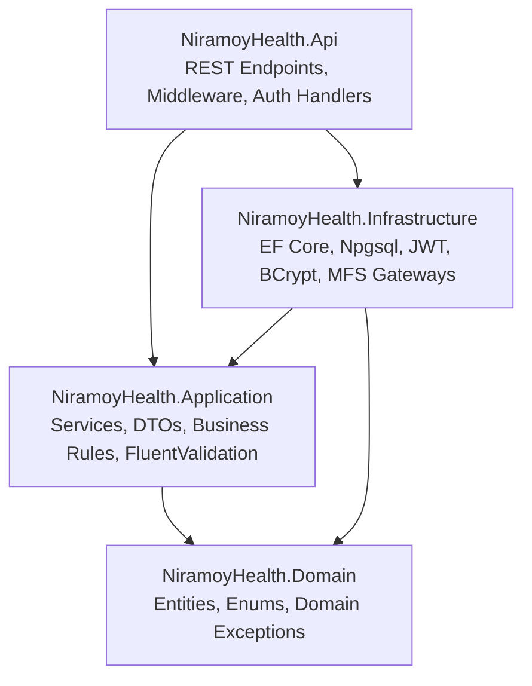
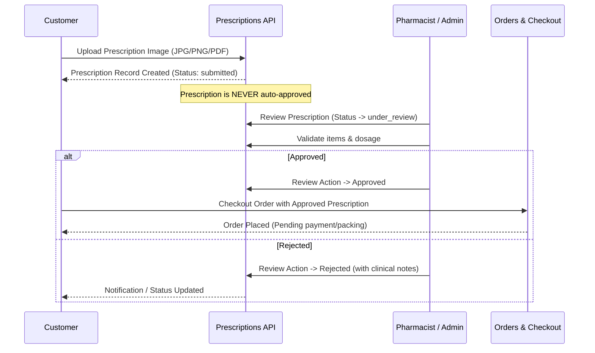

# Niramoy Health (নিরাময় হেলথ) — Backend Architecture

## 1. Architectural Overview

Niramoy Health is engineered on **Clean Architecture (Onion Architecture)** principles targeting **.NET 10** and **PostgreSQL 16+**. The system isolates core domain logic from external dependencies, database access, and transport protocols.



### Layer Responsibilities

1. **`NiramoyHealth.Domain`**
   - Pure POCO entities representing the 54 PostgreSQL tables.
   - Enums and status constants (`RoleNames`, `OrderStatuses`, `PaymentStatuses`, `PaymentTransactionStatuses`, `PrescriptionStatuses`, `DiscountTypes`).
   - Domain-specific exception types (`NotFoundException`, `ValidationException`, `ConflictException`, `BusinessRuleViolationException`, `UnauthorizedException`, `ForbiddenException`).
   - Zero dependencies on ASP.NET Core or Entity Framework Core.

2. **`NiramoyHealth.Application`**
   - Core business logic interfaces (`IAuthService`, `ICatalogService`, `ICartService`, `IOrderService`, `IPrescriptionService`, `IPaymentService`, `IAdminService`, `ISupportService`).
   - Database abstraction: `INiramoyDbContext`.
   - Strongly-typed DTOs (Data Transfer Objects) and result records.
   - FluentValidation validators for registration, BD phone numbers (`+8801...`), prescription uploads, cart mutation, and order checkout.
   - Strict price recalculation engine (never trusts prices submitted from client browsers).

3. **`NiramoyHealth.Infrastructure`**
   - `NiramoyDbContext`: EF Core mapping with Npgsql, handling JSONB metadata, UTC timestamp offsets, and PostgreSQL enum/check constraints.
   - Identity & Security: `PasswordHasher` (BCrypt with salt factor 12) and `JwtTokenService` (HMAC-SHA256 JWT access tokens + cryptographically secure 64-byte RNG refresh tokens).
   - Pluggable Payment Gateways: `BkashPaymentGateway`, `NagadPaymentGateway`, and `CodPaymentGateway`.
   - File Storage: `LocalFileStorageService` with MIME header validation, extension whitelisting, and path traversal prevention.

4. **`NiramoyHealth.Api`**
   - RESTful API controllers with versioned routing (`/api/v1/...`).
   - Global `ExceptionHandlingMiddleware` transforming exceptions into consistent RFC 7807 / standard JSON responses.
   - `SecurityHeadersMiddleware` enforcing CSP, HSTS, X-Content-Type-Options, X-Frame-Options.
   - JWT Bearer Authentication and Role-based authorization policies (`SuperAdmin`, `Admin`, `Pharmacist`, `DeliveryAgent`, `SupportAgent`, `Customer`).
   - OpenAPI / Swagger documentation integration.

---

## 2. Solution Directory Structure

```
backend/
├── NiramoyHealth.slnx
├── Directory.Build.props
├── src/
│   ├── NiramoyHealth.Domain/
│   │   ├── Entities/
│   │   │   ├── UsersAndAuth.cs
│   │   │   ├── Catalog.cs
│   │   │   ├── InventoryAndPrescriptions.cs
│   │   │   └── OrdersPaymentsAndMarketing.cs
│   │   ├── Enums/
│   │   │   └── DomainEnums.cs
│   │   └── Exceptions/
│   │       └── DomainExceptions.cs
│   │
│   ├── NiramoyHealth.Application/
│   │   ├── Common/
│   │   │   ├── Models.cs
│   │   │   └── INiramoyDbContext.cs
│   │   ├── DTOs/
│   │   │   ├── AuthAndUserDtos.cs
│   │   │   ├── CatalogDtos.cs
│   │   │   ├── CartAndWishlistDtos.cs
│   │   │   ├── PrescriptionDtos.cs
│   │   │   ├── OrderAndCheckoutDtos.cs
│   │   │   ├── PaymentDtos.cs
│   │   │   └── AdminAndSupportDtos.cs
│   │   ├── Interfaces/
│   │   ├── Services/
│   │   │   ├── AuthService.cs
│   │   │   ├── AddressService.cs
│   │   │   ├── CatalogService.cs
│   │   │   ├── CartService.cs
│   │   │   ├── WishlistService.cs
│   │   │   ├── PrescriptionService.cs
│   │   │   ├── OrderService.cs
│   │   │   ├── PaymentService.cs
│   │   │   ├── AdminService.cs
│   │   │   └── SupportService.cs
│   │   ├── Validators/
│   │   │   └── Validators.cs
│   │   └── DependencyInjection.cs
│   │
│   ├── NiramoyHealth.Infrastructure/
│   │   ├── Persistence/
│   │   │   └── NiramoyDbContext.cs
│   │   ├── Identity/
│   │   │   ├── PasswordHasher.cs
│   │   │   └── JwtTokenService.cs
│   │   ├── Storage/
│   │   │   └── LocalFileStorageService.cs
│   │   ├── Payments/
│   │   │   └── PaymentGateways.cs
│   │   └── DependencyInjection.cs
│   │
│   └── NiramoyHealth.Api/
│       ├── Controllers/
│       │   ├── BaseApiController.cs
│       │   ├── AuthController.cs
│       │   ├── AddressesController.cs
│       │   ├── ProductsController.cs
│       │   ├── CategoriesController.cs
│       │   ├── LookupsController.cs
│       │   ├── CartController.cs
│       │   ├── WishlistController.cs
│       │   ├── PrescriptionsController.cs
│       │   ├── OrdersController.cs
│       │   ├── PaymentsController.cs
│       │   ├── AdminController.cs
│       │   └── SupportController.cs
│       ├── Middleware/
│       │   ├── ExceptionHandlingMiddleware.cs
│       │   └── SecurityHeadersMiddleware.cs
│       ├── appsettings.json
│       ├── appsettings.Development.json
│       └── Program.cs
│
└── tests/
    ├── NiramoyHealth.UnitTests/
    │   ├── PricingAndDiscountsTests.cs
    │   ├── ValidationRulesTests.cs
    │   └── BusinessLogicTests.cs
    │
    └── NiramoyHealth.IntegrationTests/
        ├── NiramoyTestWebApplicationFactory.cs
        ├── AuthAndProfileTests.cs
        ├── CatalogAndCartTests.cs
        └── PrescriptionAndCheckoutTests.cs
```

---

## 3. Core Business Workflows

### 3.1. Shopping Cart & Price Security
1. **Guest or Authenticated Cart**: Supports guest tokens (`X-Guest-Token`) that seamlessly merge upon customer login via `POST /api/v1/cart/merge`.
2. **Server-Side Price Calculation**: When items are added or updated in the cart, the system queries the active product pricing and active promotions directly from PostgreSQL. Prices from frontend requests are discarded.
3. **Coupon Validation**: Checks usage limits per user, minimum cart subtotal, validity timestamps, and applies percentage or fixed discounts accurately.

### 3.2. Prescription Verification Workflow


### 3.3. Inventory Reservation & Stock Deduction
- During order creation, stock availability is checked against `product_inventory`.
- When an order is placed:
  - Inventory quantity is decremented atomically.
  - An `inventory_transactions` record is written with transaction type `'reservation'` and reference type `'order'`.
- If an order is cancelled prior to dispatch:
  - Inventory quantity is incremented back.
  - An `inventory_transactions` record is logged with transaction type `'reservation_release'`.

---

## 4. Database Concurrency & Constraints
- Optimistic concurrency control is implemented via EF Core entity properties and explicit database transactions (`IsolationLevel.ReadCommitted`).
- All DB check constraints defined in Phase 1 (`chk_order_math`, `payments_currency_check`, `prescriptions_patient_gender_check`, etc.) are respected and mirrored in the Application domain models.
