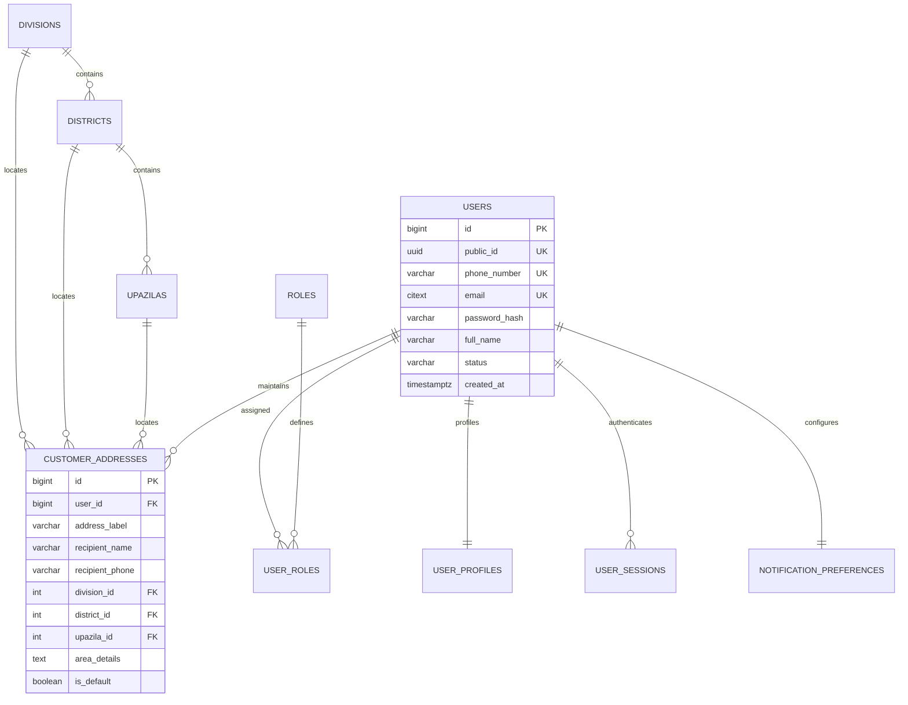
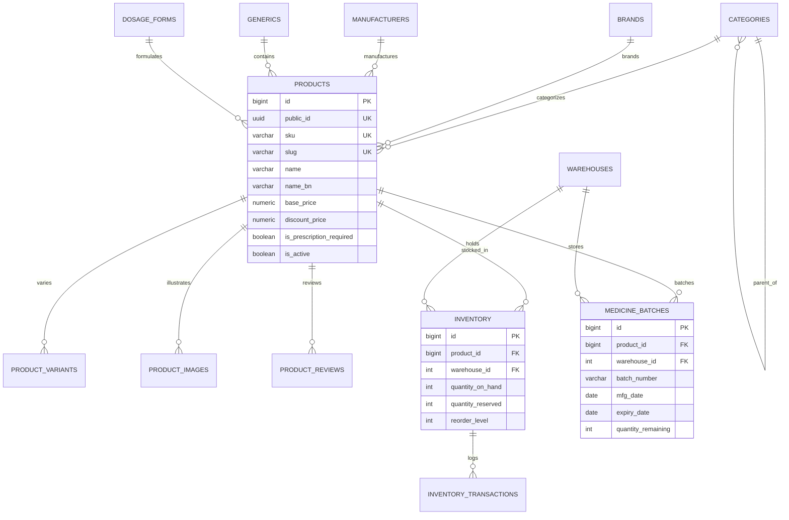
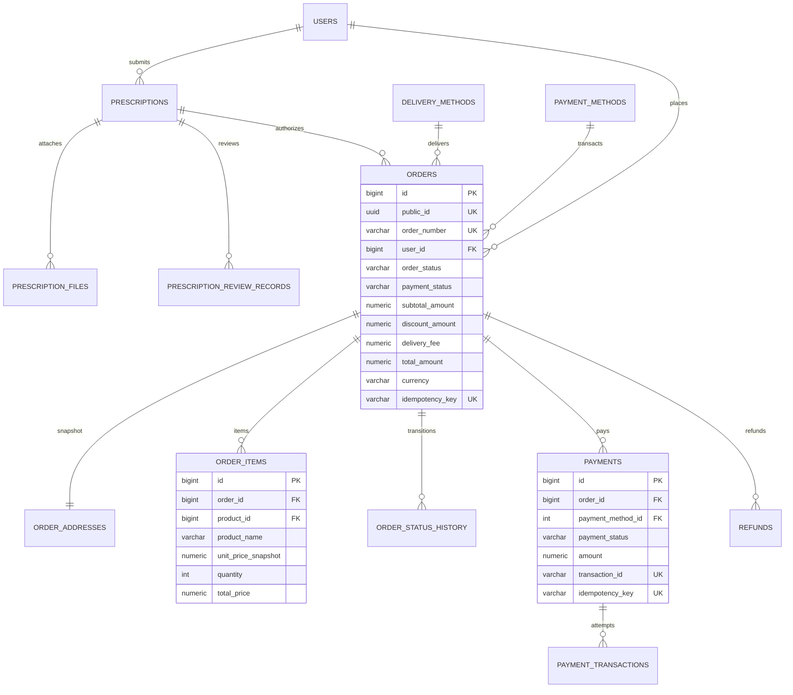

# Niramoy Health (নিরাময় হেলথ) - Database Design Document

## 1. Executive Summary & Brand Identity

**Niramoy Health** (নিরাময় হেলথ) is a production-grade, secure, and compliant digital pharmacy and healthcare e-commerce platform designed specifically for Bangladesh. Inspired by modern healthcare logistics platforms such as Arogga, Niramoy Health features an original brand identity, bilingual infrastructure (English & Bengali), and full compliance with the Directorate General of Drug Administration (DGDA) pharmaceutical safety standards.

### Core Architectural Principles

1. **Strict 3NF Relational Normalization**: Transactional data is strictly normalized to eliminate update anomalies while preserving high-speed read views.
2. **Dual-Key Architecture (Identity PK + Public UUID)**:
   - Internal Primary Keys: `BIGINT GENERATED ALWAYS AS IDENTITY` for fast indexing, low B-tree footprint, and integer foreign-key joins.
   - External Identifiers: `public_id UUID DEFAULT gen_random_uuid() NOT NULL UNIQUE` for public API endpoints and customer-facing URLs, preventing sequential ID enumeration attacks.
3. **Monetary Integrity**:
   - Zero floating-point columns. All monetary fields utilize `NUMERIC(12,2)`.
   - Invoice consistency enforced via check constraints (`total_amount = subtotal_amount - discount_amount + delivery_fee`).
4. **Pharmaceutical Compliance & Safety**:
   - Explicit prescription gating (`is_prescription_required = TRUE`).
   - Prescriptions are default-submitted and **never auto-approved**.
   - Two-phase inventory reservation to prevent overselling of life-saving medicines.
   - Medicine batch tracking with manufacturing (`mfg_date`) and expiration (`expiry_date`) dates.
5. **Bangladesh-Specific Localization**:
   - Complete 3-level administrative geography: `divisions` (8) -> `districts` (64) -> `upazilas`.
   - Mobile Financial Services (MFS) integration models for bKash, Nagad, and Rocket without storing PINs/OTPs.
   - Bilingual support across catalogs and geography with trigram fuzzy matching (`pg_trgm`).

---

## 2. Entity-Relationship Diagrams (Mermaid)

### A. Users, Geography & Authentication Domain



### B. Catalog, Pharmaceutical & Inventory Domain



### C. Prescriptions, Orders, Payments & Checkout Domain



---

## 3. Detailed Domain Specifications

### Domain 1: Users, Roles, Geography & Authentication
- **Tables**: `divisions`, `districts`, `upazilas`, `roles`, `users`, `user_roles`, `user_profiles`, `customer_addresses`, `user_sessions`.
- **Identity & Lifecycle**:
  - `users.status`: Restricted to `'active'`, `'inactive'`, `'suspended'`, `'deactivated'`, `'pending_verification'`.
  - `users.deleted_at`: Supports soft-deletion for GDPR and Bangladesh regulatory audit retention.
  - `user_sessions.token_hash`: Unique cryptographic hash of JWT refresh token with revocation tracking (`is_revoked`).
- **Bangladesh Administrative Hierarchy**:
  - 8 Divisions -> 64 Districts -> Upazilas/Thanas.
  - Ensures accurate delivery routing and localized shipping fees.

### Domain 2: Product Catalog & Pharmaceutical Models
- **Tables**: `categories`, `brands`, `manufacturers`, `generics`, `dosage_forms`, `products`, `product_variants`, `product_categories`, `product_images`, `product_attributes`, `product_reviews`.
- **Pharmaceutical Modeling**:
  - `generics`: Tracks therapeutic class, indications, dosage guidelines, precautions, and FDA pregnancy categories (A, B, C, D, X).
  - `dosage_forms`: Bilingual representation (e.g. Tablet / ট্যাবলেট, Capsule / ক্যাপসুল).
  - `products.is_prescription_required`: Boolean flag required to place item into pharmacist validation workflow.
  - `products.discount_price`: Check constraint enforces `discount_price <= base_price`.

### Domain 3: Inventory & Pharmaceutical Batch Tracking
- **Tables**: `warehouses`, `inventory`, `medicine_batches`, `inventory_transactions`.
- **Concurrency Control & Safety**:
  - `inventory.quantity_reserved <= inventory.quantity_on_hand` enforced at schema level.
  - `medicine_batches`: Mandatory `expiry_date > mfg_date`. Expiry alerts prevent dispensing of near-expiry medicines.
  - `inventory_transactions`: Double-entry transaction history tracking receipts, sales, reservations, adjustments, and expired write-offs.

### Domain 4: Shopping Carts & Wishlists
- **Tables**: `carts`, `cart_items`, `wishlists`, `wishlist_items`.
- **Guest vs Authenticated Strategy**:
  - Carts support registered users via `user_id` or guest sessions via `guest_token UUID`.
  - Constraint `chk_cart_owner` ensures XOR exclusivity: either `user_id` OR `guest_token` must be present.
  - **Dynamic Price Integrity**: Carts do NOT store prices. Prices are recalculated live from `products` during checkout to prevent client-side tampering.

### Domain 5: Prescriptions & Pharmacist Verification
- **Tables**: `prescriptions`, `prescription_files`, `prescription_review_records`.
- **Clinical Governance**:
  - Prescriptions default to status `submitted`.
  - Licensed pharmacists review images/PDFs, verify against BMDC registry, and record decision notes in `prescription_review_records`.
  - `prescription_files.storage_provider` and `file_storage_key`: Files are securely stored in cloud buckets (e.g. S3/Azure Blob/Local) with authenticated access only.

### Domain 6 & 7: Orders, Delivery & Bangladesh Checkout
- **Tables**: `delivery_methods`, `payment_methods`, `orders`, `order_addresses`, `order_items`, `order_status_history`, `payments`, `payment_transactions`, `refunds`.
- **Immutable Financial Snapshots**:
  - `order_items` stores `unit_price_snapshot`, `product_name`, and `product_sku` at the exact instant of purchase.
  - `order_addresses` stores snapshot of recipient name, phone, and delivery address.
- **Idempotency & MFS Integration**:
  - `orders.idempotency_key` and `payments.idempotency_key` prevent double submissions.
  - Sensitive payment credentials (bKash/Nagad PIN, OTP) are **strictly forbidden** from database storage. Only external gateway transaction IDs (`trxID`) and sanitized webhook payloads are retained.

### Domain 8: Delivery Zones, Promotions & Marketing
- **Tables**: `delivery_zones`, `coupons`, `coupon_usages`, `promotional_campaigns`, `banners`, `homepage_sections`, `newsletter_subscribers`.
- **Promotion Governance**:
  - Coupons support percentage and fixed discounts with minimum order amounts and maximum discount caps.
  - Usage tracked per user via `coupon_usages` to enforce quotas.

### Domain 9: Notifications & Customer Support
- **Tables**: `notifications`, `notification_preferences`, `support_tickets`, `support_messages`.
- **Customer Care**:
  - Multi-tier support tickets (`low`, `medium`, `high`, `urgent`) linked to order references.
  - Threaded conversation logs between customers and support agents.

### Domain 10: Administration, Auditing & Operational Reporting
- **Tables**: `audit_logs`, `administrative_actions`, `app_configurations`.
- **Operational Views**:
  - `vw_product_stock_status`: Live inventory status (`IN_STOCK`, `LOW_STOCK`, `OUT_OF_STOCK`).
  - `vw_low_stock_alerts`: Restock alerts for warehouse managers.
  - `vw_prescription_review_queue`: Live queue for pharmacists prioritized by wait time.
  - `vw_daily_sales_summary`: GMV, net revenue, discounts, COD vs MFS share.
  - `vw_customer_order_summary`: Customer lifetime order count and total spend.
  - `vw_top_selling_products`: Revenue and quantity rankings.

---

## 4. EF Core Compatibility & Mapping Strategy (Phase 2)

### A. Authoritative Source of Truth Decision

**Decision**: **SQL-First Schema Management is Authoritative**.
- The hand-maintained, ordered SQL scripts under `/sql/` serve as the single source of truth for database schema, constraints, triggers, and views.
- EF Core in Phase 2 will map to this schema using standard Fluent API configuration in `DbContext.OnModelCreating()`.
- EF Core migrations will NOT drop or alter database objects directly; instead, any schema modifications will originate as versioned SQL scripts in `/sql/` and subsequently be reflected in EF Core entity definitions.

### B. Entity & Type Mapping Specifications

| Database Type | EF Core .NET Type | Mapping Configuration |
|---|---|---|
| `BIGINT GENERATED ALWAYS AS IDENTITY` | `long` | `.ValueGeneratedOnAdd()` |
| `INT GENERATED ALWAYS AS IDENTITY` | `int` | `.ValueGeneratedOnAdd()` |
| `UUID` | `Guid` | `HasDefaultValueSql("gen_random_uuid()")` |
| `NUMERIC(12,2)` | `decimal` | `.HasPrecision(12, 2)` |
| `TIMESTAMPTZ` | `DateTimeOffset` or `DateTime` (UTC) | `.HasColumnType("timestamp with time zone")` |
| `CITEXT` / `VARCHAR` | `string` | `.HasMaxLength(N)` |
| `BOOLEAN` | `bool` | Default `false` / `true` |
| `JSONB` | `string` or `JsonDocument` or Strong Model | `.HasColumnType("jsonb")` |

### C. Example EF Core Entity Mapping (Order Entity)

```csharp
public class OrderConfiguration : IEntityTypeConfiguration<Order>
{
    public void Configure(EntityTypeBuilder<Order> builder)
    {
        builder.ToTable("orders");
        builder.HasKey(o => o.Id);
        builder.Property(o => o.Id).HasColumnName("id").UseIdentityAlwaysColumn();
        builder.Property(o => o.PublicId).HasColumnName("public_id").HasDefaultValueSql("gen_random_uuid()");
        builder.Property(o => o.OrderNumber).HasColumnName("order_number").HasMaxLength(50).IsRequired();
        builder.Property(o => o.SubtotalAmount).HasColumnName("subtotal_amount").HasPrecision(12, 2);
        builder.Property(o => o.DiscountAmount).HasColumnName("discount_amount").HasPrecision(12, 2);
        builder.Property(o => o.DeliveryFee).HasColumnName("delivery_fee").HasPrecision(12, 2);
        builder.Property(o => o.TotalAmount).HasColumnName("total_amount").HasPrecision(12, 2);
        builder.Property(o => o.Currency).HasColumnName("currency").HasMaxLength(3).HasDefaultValue("BDT");
        
        // Navigation Relationships
        builder.HasOne(o => o.User).WithMany(u => u.Orders).HasForeignKey(o => o.UserId).OnDelete(DeleteBehavior.Restrict);
        builder.HasOne(o => o.DeliveryAddress).WithOne().HasForeignKey<OrderAddress>(oa => oa.OrderId).OnDelete(DeleteBehavior.Cascade);
        builder.HasMany(o => o.Items).WithOne(i => i.Order).HasForeignKey(i => i.OrderId).OnDelete(DeleteBehavior.Cascade);
        builder.HasMany(o => o.Payments).WithOne(p => p.Order).HasForeignKey(p => p.OrderId).OnDelete(DeleteBehavior.Restrict);
    }
}
```
