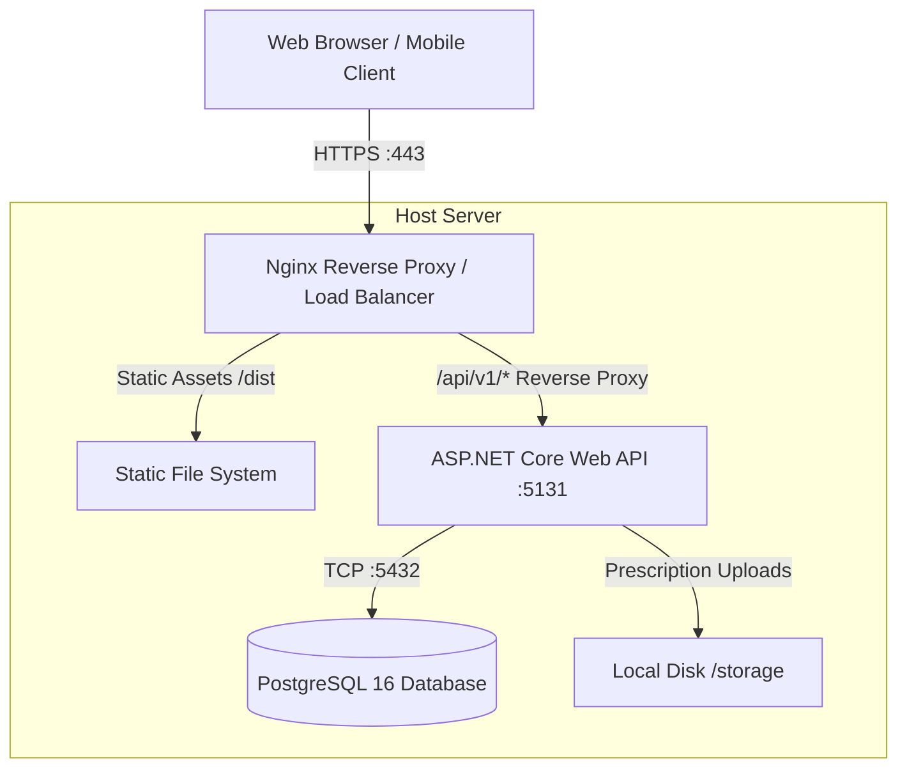

# Niramoy Health (নিরাময় হেলথ) — Deployment Guide

## 1. Overview & Production Deployment Architecture

The Niramoy Health application consists of two runtime components that can be hosted independently or unified under a single host:
1. **Frontend SPA**: Vanilla ES Modules bundled with Vite and Tailwind CSS. Generates static assets (`dist/`) suitable for high-performance CDN edge caching or direct hosting.
2. **Backend Web API**: ASP.NET Core 10 Web API compiled into self-contained or framework-dependent executables running behind a reverse proxy (Nginx / Caddy / Cloudflare).
3. **Database**: PostgreSQL 16+ with persistent connection pooling and automated backups.



---

## 2. Automated Production Build

### 2.1. Frontend Static Build
To compile the minified frontend bundle:
```bash
cd frontend
npm install
npm run build
```
This generates the optimized bundle in `frontend/dist/`:
- `dist/index.html` (~1.8 kB)
- `dist/assets/index-[hash].css` (~43 kB)
- `dist/assets/index-[hash].js` (~620 kB)

### 2.2. Sync Frontend to ASP.NET Core `wwwroot` (Single-Host Mode)
For an all-in-one deployment where the ASP.NET Core server serves both the static SPA and the Web API:
```bash
rm -rf backend/src/NiramoyHealth.Api/wwwroot/*
cp -r frontend/dist/* backend/src/NiramoyHealth.Api/wwwroot/
```

### 2.3. Backend Production Compilation
Publish the ASP.NET Core project in `Release` mode:
```bash
dotnet publish backend/src/NiramoyHealth.Api/NiramoyHealth.Api.csproj \
  -c Release \
  -o ./publish/niramoy-api
```

---

## 3. Reverse Proxy Configuration (Nginx)

Below is the recommended production Nginx server configuration with TLS and static caching:

```nginx
server {
    listen 80;
    server_name niramoyhealth.com www.niramoyhealth.com;
    return 301 https://$host$request_uri;
}

server {
    listen 443 ssl http2;
    server_name niramoyhealth.com www.niramoyhealth.com;

    # SSL Certificates (Let's Encrypt / Certbot)
    ssl_certificate /etc/letsencrypt/live/niramoyhealth.com/fullchain.pem;
    ssl_certificate_key /etc/letsencrypt/live/niramoyhealth.com/privkey.pem;
    ssl_protocols TLSv1.2 TLSv1.3;
    ssl_ciphers HIGH:!aNULL:!MD5;

    # Gzip Compression
    gzip on;
    gzip_types text/plain text/css application/json application/javascript text/xml application/xml application/xml+rss text/javascript image/svg+xml;

    # Root Directory for Frontend SPA
    root /var/www/niramoyhealth/frontend/dist;
    index index.html;

    # Static Assets with Cache Busting
    location /assets/ {
        expires 1y;
        add_header Cache-Control "public, immutable";
    }

    # SPA Fallback Routing
    location / {
        try_files $uri $uri/ /index.html;
    }

    # Reverse Proxy to ASP.NET Core API
    location /api/ {
        proxy_pass http://127.0.0.1:5131/api/;
        proxy_http_version 1.1;
        proxy_set_header Upgrade $http_upgrade;
        proxy_set_header Connection keep-alive;
        proxy_set_header Host $host;
        proxy_set_header X-Real-IP $remote_addr;
        proxy_set_header X-Forwarded-For $proxy_add_x_forwarded_for;
        proxy_set_header X-Forwarded-Proto $scheme;
        proxy_cache_bypass $http_upgrade;
        client_max_body_size 15M; # Allows prescription uploads up to 15MB
    }
}
```

---

## 4. Systemd Service Setup (Linux)

To manage the ASP.NET Core API background daemon with automatic restart on reboot:

Create `/etc/systemd/system/niramoy-api.service`:
```ini
[Unit]
Description=Niramoy Health ASP.NET Core Web API
After=network.target postgresql.service

[Service]
Type=notify
WorkingDirectory=/var/www/niramoyhealth/publish/niramoy-api
ExecStart=/usr/bin/dotnet /var/www/niramoyhealth/publish/niramoy-api/NiramoyHealth.Api.dll --urls "http://127.0.0.1:5131"
Restart=always
RestartSec=10
KillSignal=SIGINT
SyslogIdentifier=niramoy-api
User=www-data
Environment=ASPNETCORE_ENVIRONMENT=Production
Environment=DOTNET_PRINT_TELEMETRY_MESSAGE=false
Environment=ConnectionStrings__DefaultConnection="Host=127.0.0.1;Port=5432;Database=niramoy_health_prod;Username=niramoy_prod_user;Password=SECURE_PASSWORD;"
Environment=Jwt__SecretKey="CHANGE_TO_A_64_CHAR_HEX_KEY_FOR_PRODUCTION_SECURITY"

[Install]
WantedBy=multi-user.target
```

Enable and start the service:
```bash
sudo systemctl daemon-reload
sudo systemctl enable niramoy-api.service
sudo systemctl start niramoy-api.service
sudo systemctl status niramoy-api.service
```

---

## 5. Database Migration & Seed Verification

Prior to launching production traffic:
1. Ensure the PostgreSQL database is migrated and indexed using the scripts in `/sql`:
   ```bash
   psql -h 127.0.0.1 -U niramoy_prod_user -d niramoy_health_prod -f sql/01_schema.sql
   psql -h 127.0.0.1 -U niramoy_prod_user -d niramoy_health_prod -f sql/02_constraints_and_indexes.sql
   psql -h 127.0.0.1 -U niramoy_prod_user -d niramoy_health_prod -f sql/03_seed_data.sql
   ```
2. Verify all tables, check constraints, foreign keys, and indexes exist.
3. Configure automated daily backups using `pg_dump`:
   ```bash
   pg_dump -U niramoy_prod_user -F c niramoy_health_prod > /var/backups/niramoy_$(date +\%F).dump
   ```

---

## 6. Health Checks & Monitoring

- **Health Endpoint**: `GET http://127.0.0.1:5131/health` returns `200 OK` with status `Healthy` and active PostgreSQL connection state.
- **Log Inspection**: Inspect production logs via systemd:
  ```bash
  journalctl -u niramoy-api.service -f
  ```
