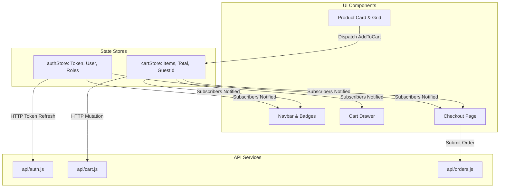

# Niramoy Health (নিরাময় হেলথ) — Frontend Architecture

## 1. Overview & Architectural Philosophy

**Niramoy Health (নিরাময় হেলথ)** is a high-performance, responsive healthcare e-commerce Single Page Application (SPA) designed specifically for the Bangladeshi digital pharmacy ecosystem. 

Inspired by the workflow and accessibility of modern digital pharmacies like Arogga, Niramoy Health presents an original brand identity, warm emerald/teal clinical color palette, bilingual Bengali and English interface, and strict regulatory adherence for prescription drug ordering.

### Architectural Principles:
1. **Zero Bloat Vanilla ES Modules SPA**: Built with native JavaScript ES Modules without heavyweight UI framework overhead (React/Angular), achieving sub-second initial load times, instant interactivity, and exceptional lighthouse metrics.
2. **Component-Driven Modular Architecture**: Clean separation between state stores, API clients, reusable UI components, and top-level page views.
3. **Reactive Global State with Pub-Sub**: Predictable unidirectionally dispatched state for authentication, cart items, delivery location, and notifications.
4. **Client-Side Hash & History Routing**: Smooth client-side navigation with route guards for authenticated customer accounts and role-based access for administrative portals.
5. **Fail-Safe Offline/Guest Resiliency**: Transparent guest cart tracking using UUIDs synced with local storage and automatically merged into customer accounts upon authentication.

---

## 2. Directory Structure

The frontend is located under `frontend/` and follows a structured modular layout:

```text
frontend/
├── index.html                   # HTML entry point with meta tags, SEO, and font links
├── package.json                 # Dependencies (Tailwind, Lucide, Vite, Playwright)
├── vite.config.js               # Vite build configuration and API reverse-proxy
├── tailwind.config.js           # Theme colors (brand-primary, emerald, amber), typography
├── postcss.config.js            # PostCSS plugins (TailwindCSS, Autoprefixer)
├── playwright.config.js         # End-to-end browser test configuration
├── tests/                       # Browser automated end-to-end test suites
│   ├── storefront.spec.js       # Homepage, catalog search, responsive layout tests
│   ├── cart-and-checkout.spec.js# Guest to user checkout and order tracking tests
│   └── prescriptions-and-admin.spec.js # Upload verification and admin review tests
└── src/
    ├── main.js                  # Application entry point, router initialization, listeners
    ├── api/                     # Backend communication layer
    │   ├── client.js            # Fetch wrapper with interceptors and error normalization
    │   ├── auth.js              # Registration, login, profile, token refresh
    │   ├── catalog.js           # Products, categories, search, deals, generics
    │   ├── cart.js              # Guest/user cart CRUD, item quantity mutation
    │   ├── checkout.js          # Delivery zones, address creation, order submission
    │   ├── orders.js            # Order listing, order details, cancellation
    │   ├── prescriptions.js     # Multipart file upload, customer prescription queue
    │   └── admin.js             # Staff stats, order management, prescription triage
    ├── state/                   # Reactive global state stores
    │   ├── authStore.js         # JWT token, current user, role checks, login/logout
    │   └── cartStore.js         # Guest UUID, cart items, subtotal, quantity badges
    ├── router/
    │   └── index.js             # Hash-based SPA router with parameters & route guards
    ├── components/              # Reusable UI widgets and presentation elements
    │   ├── Navbar.js            # Top utility bar, search input, cart trigger, user menu
    │   ├── Footer.js            # Arogga-style footer, DGDA compliance, hotline, social
    │   ├── ProductCard.js       # Product badge, price, generic, prescription indicator
    │   ├── CartDrawer.js        # Slide-over cart preview, item quantity controls, CTA
    │   ├── PrescriptionModal.js # Prescription upload dialog with drag-drop and notes
    │   └── Toast.js             # Ephemeral success/warning/error feedback banner
    ├── pages/                   # Top-level view controllers
    │   ├── HomePage.js          # Hero banners, quick categories, deals, value propositions
    │   ├── CatalogPage.js       # Product grid, search filter, category & brand facets
    │   ├── ProductDetailPage.js # Gallery, generic composition, dosage, stock, add to cart
    │   ├── PrescriptionPage.js  # Dedicated prescription upload & customer history
    │   ├── CartPage.js          # Full shopping cart review page
    │   ├── CheckoutPage.js      # Address selection, delivery method, COD/bKash selection
    │   ├── OrderSuccessPage.js  # Confirmation receipt, tracking ID, invoice summary
    │   ├── OrdersPage.js        # Customer order history, timeline tracking, status badges
    │   ├── LoginPage.js         # Phone/email sign-in with redirect preservation
    │   ├── RegisterPage.js      # Customer onboarding with phone & validation
    │   └── AdminDashboardPage.js# Staff management: prescription review, order approvals
    └── css/
        └── style.css            # Tailwind directives, custom glassmorphism, fonts
```

---

## 3. State Management Architecture

Global client-side state is handled via decoupled reactive stores implemented using the Observer pattern:



### 3.1. `authStore`
- **State Properties**: `token` (JWT string), `refreshToken`, `user` (`{ id, fullName, email, phoneNumber, role }`), `isAuthenticated`.
- **Persistence**: Synced with `localStorage` keys `niramoy_token`, `niramoy_refresh_token`, and `niramoy_user`.
- **Role Helpers**: `isAdmin()`, `isPharmacist()`, `isStaff()` for immediate conditional rendering and route protection.
- **Login/Logout Lifecycle**:
  - `login(authData)`: Stores credentials, triggers cart reconciliation, updates navbar avatar.
  - `logout()`: Clears storage, resets state, generates fresh guest token, redirects to homepage.

### 3.2. `cartStore`
- **State Properties**: `items` (Array of line items), `subtotal`, `discountTotal`, `deliveryFee`, `total`, `guestToken`.
- **Guest-to-User Synchronization**:
  - Initializes anonymous sessions with an RFC-compliant UUID stored in `niramoy_guest_token`.
  - When a guest signs in or creates an account, `cartStore.mergeGuestCart()` invokes the backend endpoint `POST /api/v1/cart/merge`, seamlessly transitioning guest items into the authenticated customer account.

---

## 4. Routing Architecture

Niramoy Health utilizes client-side hash routing (`window.location.hash`) for zero server-side route rewrites and seamless compatibility with ASP.NET Core static file serving.

### 4.1. Route Registry
| Path | Page View | Access Control |
|---|---|---|
| `#` / `#/` | `HomePage` | Public |
| `#/catalog` | `CatalogPage` | Public |
| `#/product/:slug` | `ProductDetailPage` | Public |
| `#/cart` | `CartPage` | Public / Guest |
| `#/checkout` | `CheckoutPage` | Authenticated Customer |
| `#/order-success/:orderNumber` | `OrderSuccessPage` | Authenticated Customer |
| `#/orders` | `OrdersPage` | Authenticated Customer |
| `#/prescriptions` | `PrescriptionPage` | Authenticated Customer |
| `#/login` | `LoginPage` | Anonymous / Redirect |
| `#/register` | `RegisterPage` | Anonymous |
| `#/admin` | `AdminDashboardPage` | Staff / Admin / Pharmacist |

### 4.2. Route Guards & Navigation Interceptors
The router checks user roles and authentication status before rendering targeted pages:
- If an unauthenticated user navigates to `#/checkout` or `#/prescriptions`, the router captures the destination (`#/login?redirect=checkout`) and redirects to login.
- Upon successful authentication, `LoginPage` reads the query parameter and immediately routes the user back to their intended checkout or prescription workflow.
- If a standard customer attempts to navigate to `#/admin`, the router blocks the view, dispatches an access denied alert, and navigates to the storefront.

---

## 5. Design System & Styling

The user interface uses Tailwind CSS v3.4 customized to reflect trust, precision, and healthcare safety.

### 5.1. Color Palette
- **Primary Brand (Emerald)**: `#059669` (Tailwind `emerald-600`), `#047857` (hover `emerald-700`), `#ecfdf5` (tint `emerald-50`). Represents healing, natural medicine, and reliability.
- **Secondary (Teal / Cyan)**: `#0d9488` (Tailwind `teal-600`), `#0f766e` (`teal-700`). Used for clinical action items and verification badges.
- **Accent (Amber / Orange)**: `#f59e0b` (`amber-500`), `#d97706` (`amber-600`). Used for urgent prescription warnings, discounts, and flash sales.
- **Status Indicators**:
  - *Success (Approved / Delivered)*: `emerald-600`
  - *Pending / Submitted Review*: `amber-500`
  - *Rejected / Out of Stock*: `rose-600`
  - *Processing / Dispatched*: `indigo-600`

### 5.2. Typography & Bilingual Support
- **English**: `Inter`, system-ui, sans-serif.
- **Bengali (বাংলা)**: `Hind Siliguri`, loaded via Google Fonts for authentic rendering of Bangladeshi medicine names (e.g. *নাপা এক্সট্রা*), price currency symbols (৳), and guidance notices.
