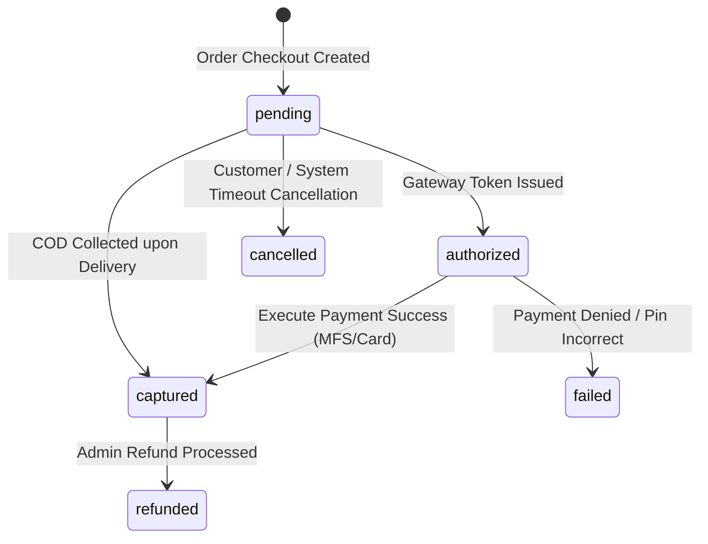

# Niramoy Health (নিরাময় হেলথ) — Payment Integration Guide

## 1. Overview

Niramoy Health supports real-world Bangladeshi digital payment flows, including **Mobile Financial Services (MFS)** and **Cash on Delivery (COD)**:
1. **bKash PGW (Direct Checkout API v1.2.0-CA)**
2. **Nagad Online Payment Gateway**
3. **Cash on Delivery (COD)**
4. **Card / SSLCOMMERZ** (Extensible gateway interface)

All payment interactions are abstracted behind the `IPaymentGateway` interface in `NiramoyHealth.Application.Interfaces`, allowing test stubs, sandbox environments, and live production credentials to be swapped via configuration without altering core business logic.

---

## 2. Payment Lifecycle & State Machine

### Order Status vs Payment Status Alignment

| Action | `orders.order_status` | `orders.payment_status` | `payments.payment_status` |
|---|---|---|---|
| Order Created | `pending` | `unpaid` | `pending` |
| MFS Payment Success | `confirmed` | `paid` | `captured` |
| MFS Payment Failed | `pending` | `unpaid` | `failed` |
| COD Delivery Complete | `delivered` | `paid` | `captured` |
| Full Refund Issued | `cancelled` | `refunded` | `refunded` |

---

## 3. Supported Gateways

### 3.1. bKash Gateway (`bkash`)
- **Initialization**:
  - Endpoint: `POST /api/v1/payments/initiate`
  - Calls bKash Tokenized/Direct API to create a payment session with `amount`, `currency=BDT`, `merchantInvoiceNumber=ORD-XXXXXXXX`.
  - Returns `redirectUrl` or `gatewayPaymentId`.
- **Execution**:
  - Endpoint: `POST /api/v1/payments/execute`
  - Validates `paymentID` and executes against bKash API.
  - Generates verified transaction ID (`trxID`).
- **Refunds**:
  - Invokes `POST /tokenized/checkout/payment/refund` with `paymentID`, `trxID`, `amount`, and `sku`.

### 3.2. Nagad Gateway (`nagad`)
- **Initialization**:
  - Generates merchant public-key signed challenge and initializes checkout URL with Nagad PGW.
- **Callback / Execution**:
  - Nagad redirects customer back with payment reference ID.
  - API executes verification and records `issuer_trx_id`.

### 3.3. Cash on Delivery (`cod`)
- No upstream gateway redirect is required.
- Order is placed with initial status `pending` and payment status `unpaid`.
- Payment record is created with provider `cod` in `pending` status.
- Once the delivery agent fulfills the package, the payment record is transitioned to `captured` and the order payment status to `paid`.

---

## 4. Idempotency & Concurrency Guarantees

1. **Client-Supplied Idempotency Keys**:
   - `orders.idempotency_key` ensures network retry storms from mobile apps do not duplicate orders or double-charge customers.
   - Unique constraint `orders_idempotency_key_key` rejects identical requests within the active checkout window.

2. **Transaction Uniqueness**:
   - `payments.transaction_id` enforces unique constraints in PostgreSQL (`payments_transaction_id_key`).
   - Prevents duplicate credit from double webhook deliveries.

3. **Database Audit Log**:
   - Every raw JSON response received from third-party payment gateways is sanitized (stripping PINs or CVVs) and saved into the `payment_transactions` table with timestamps and status codes.

---

## 5. Refunds & Reversals

- Full or partial refunds are processed via `PaymentService.ProcessRefundAsync`.
- Only payments in `captured` status can be refunded.
- Verifies that `refund_amount <= payment.amount`.
- Automatically logs entries into `refunds` table with `processed_by` admin identity and updates the order status history timeline.
